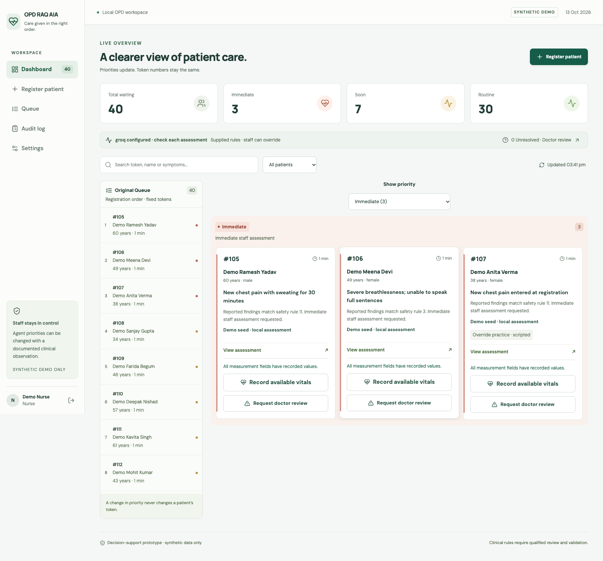
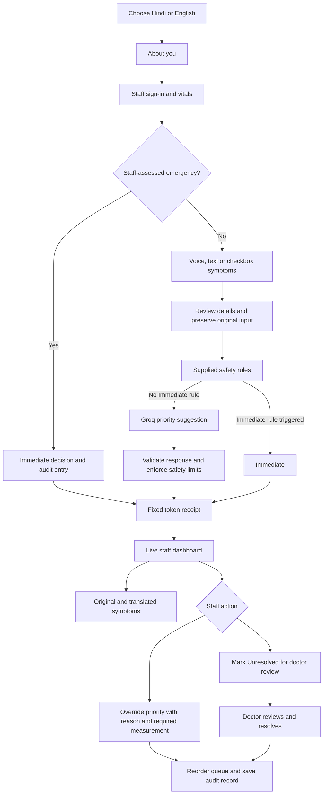

# OPD RAQ AIA

**Clinical urgency matters, not just parcha numbers.**

OPD RAQ AIA is a hackathon prototype for patient registration and queue prioritisation. It keeps each patient's original token number and orders the staff queue by Immediate, Soon or Routine. Doctors, nurses, interns and junior residents can review the assessment and change the priority.

**Synthetic demonstration only. This application has not been clinically validated and must not be used for real patient care.**

- [GitHub repository](https://github.com/RujalRaj/OPD-RAQ-AIA)
- [Deployment setup](docs/deployment.md)
- [AI setup](docs/live-ai-setup.md)



## What works

- Hindi and English registration with text, voice and grouped symptom checkboxes.
- Recorded spoken instructions with replay controls. Browser speech recognition is optional.
- Staff-led vitals entry before symptoms. Temperature and pulse accept a numeric reading or High/Low; SpO₂ requires a numeric reading. Other vitals can be recorded when available.
- A staff-assessed emergency shortcut that assigns Immediate and records the staff decision.
- Groq integration using `openai/gpt-oss-120b` for live priority suggestions, with the supplied safety rules checked first.
- A dashboard that opens on Immediate, with a dropdown for Soon and Routine. Original registration order remains visible.
- Separate **Original** and **Translated in Hindi/English** symptom boxes. Original input stays unchanged. Checkbox labels use the bilingual catalog; free text uses a cached translation. The prepared demo phrases also work offline.
- Staff overrides, unresolved cases sent for doctor review, and an audit trail.

## Current workflow



If the model is unavailable, the source-rule result remains visible with a request for staff review. The app does not mark a missing vital as normal. High/Low is a qualitative observation, not a fabricated numeric reading. Translation is for display and never changes the assessment.

## Tech stack

| Part | Technology |
| --- | --- |
| Interface | React 19, TypeScript, Vite 7, CSS |
| API | Python 3.12, FastAPI, Pydantic |
| Database | SQLite, SQLAlchemy 2 |
| Live AI | Groq API, `openai/gpt-oss-120b`, OpenAI Python SDK |
| Alternative provider | OpenAI API, `gpt-4o-mini` |
| Voice | Bundled Hindi/English audio, optional browser speech recognition |
| Tests | pytest, Vitest, Playwright, axe-core |
| Hosting | Docker; React build and FastAPI served from one origin |

We use a pretrained model through an API. We have not trained or fine-tuned a model. JSON schemas constrain responses; backend checks enforce permissions and preserve source safety rules and staff decisions.

## Run locally in VS Code

Install **Python 3.12**, **Node.js 24** and **Git**. Java is not required.

Clone the repository and open its root folder in VS Code:

```sh
git clone https://github.com/RujalRaj/OPD-RAQ-AIA.git
cd OPD-RAQ-AIA
python3.12 -m venv .venv
.venv/bin/python -m pip install -r backend/requirements-lock.txt
.venv/bin/python -m backend.seed_hackathon --activate
cd frontend
npm ci
cd ..
```

On Windows, use `py -3.12 -m venv .venv` and replace `.venv/bin/python` with `.venv\Scripts\python.exe`.

Start the backend in the first terminal, from the repository root:

```sh
.venv/bin/python -m uvicorn backend.main:app --reload --host 127.0.0.1 --port 8000
```

Start the frontend in a second terminal:

```sh
cd frontend
npm run dev
```

Open [the local app](http://127.0.0.1:5173). Do not run `backend/main.py` directly. Both terminals must stay open.

The included VS Code tasks offer the same setup, start and test commands.

## Connect Groq

Create a key at [Groq Console](https://console.groq.com/keys), then run from the repository root:

```sh
.venv/bin/python -m scripts.setup_ai --provider groq
.venv/bin/python -m scripts.check_ai
```

Paste the key into the hidden prompt. Restart the backend after changing its configuration. A successful connection check prints `LIVE RESPONSE VERIFIED`.

The key is stored in the ignored local `.env` file. It is never included in the React build or GitHub repository. A public deployment needs its own server-side environment variable; it cannot read your laptop's `.env` file.

## Demonstration

Choose a staff role and click **Fill credentials**, then **Open staff workspace**. Demo usernames are `nurse`, `doctor`, `intern` and `jr`; the shared demo password is `DemoOnly!2026`.

The curated starting queue contains **3 Immediate, 7 Soon and 30 Routine** patients. These are prepared local-rule cases, clearly labelled as demo seed assessments. New eligible registrations and reassessments use the configured live model.

**Override example:** open **Demo Anita Verma** in Immediate. The case includes a scripted registration-error scenario. Choose Routine, enter the staff clarification in the reason box, select Pulse and a synthetic reading such as 82 in the measurement box, then apply the override. The token stays the same and the patient moves to Routine. This is a rehearsed scenario, not evidence of a measured model error.

For nurse, intern and JR overrides, the backend requires a reason and at least one new numeric measurement. Doctors must supply a reason. **Request doctor review** marks a case Unresolved; only a doctor can resolve it with a note.

Running the seed command again preserves existing overrides. Previous active demo records are archived, not deleted, and a local database backup is created before activation.

## Tests

From the repository root:

```sh
.venv/bin/python -m pytest -q
.venv/bin/python -m backend.evaluate_cases
```

From `frontend`:

```sh
npm run test -- --run
npm run build
npx playwright install chromium
npm run test:e2e
```

Browser tests use separate local ports and a separate synthetic database. Automated tests check software behaviour, not clinical accuracy.

## Project files

- `frontend/src/`: registration, dashboard, patient detail and audio controls.
- `backend/main.py`: API routes, staff access, model jobs and translation jobs.
- `backend/services/`: safety rules, symptom processing, model calls and translation.
- `backend/fixtures/`: supplied safety matrix, bilingual catalog and synthetic cases.
- `tests/`, `frontend/e2e/`: API and browser checks.
- [Architecture and API](docs/architecture.md), [source gaps](docs/source-gaps.md), [verification history](docs/verification.md).

The original handoff and battle-plan workbook remain in the repository as reference documents. Later workflow changes are described here and in the implementation documentation.

## Current limits

This is a shared synthetic demo with fixed demonstration credentials. It has no real ABHA connection, diagnosis or prescription service. Model suggestions and translations can be wrong and need staff review. Browser speech recognition depends on browser support and may need internet. Hosted inference needs internet; the local database, form, recorded instructions and source-rule fallback can continue without it.

On a free Render instance, SQLite data is temporary and can reset when the instance restarts. The initial demo queue is restored only when the database is empty. Local SQLite data persists on the laptop. See [deployment details](docs/deployment.md).

## Future prospect

1. **ABDM / ABHA integration:** connect registration with the ABDM sandbox, then follow the requirements for authorised patient record access.
2. **Clinician assistance in diagnosis:** use symptoms, vitals, patient history and the doctor's conversation to support the clinician's assessment, with clinician review.
3. **Prescription and patient leaflet:** draft a prescription sheet for the doctor to approve, with patient instructions in the patient's language.
4. **Follow-up and emergency reminders:** send follow-up reminders and allow patients to alert the care team about an emergency. This would need a defined response process.
5. **Better model integration:** compare models on Hindi, English and locally used expressions before selecting them for the workflow.
6. **More comprehensive safety rules:** expand the rules with clinician input and evaluate them before any clinical use.
7. **Offline operation:** support local inference and a local network deployment for medical colleges with unreliable internet. Operation during a power cut would still require charged devices or backup power.
