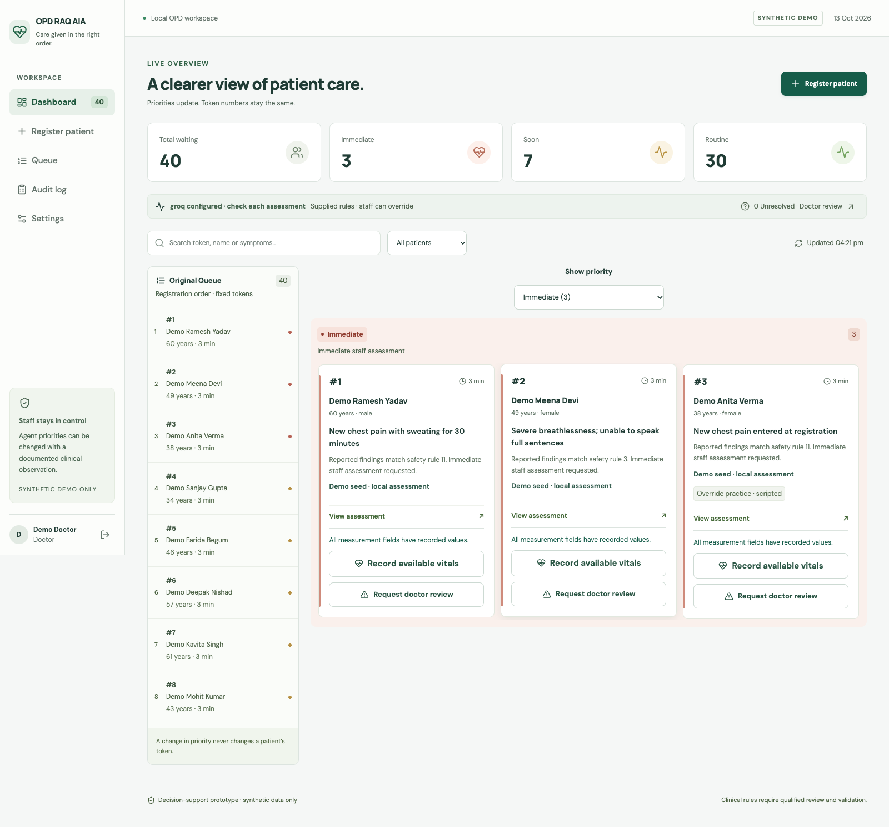
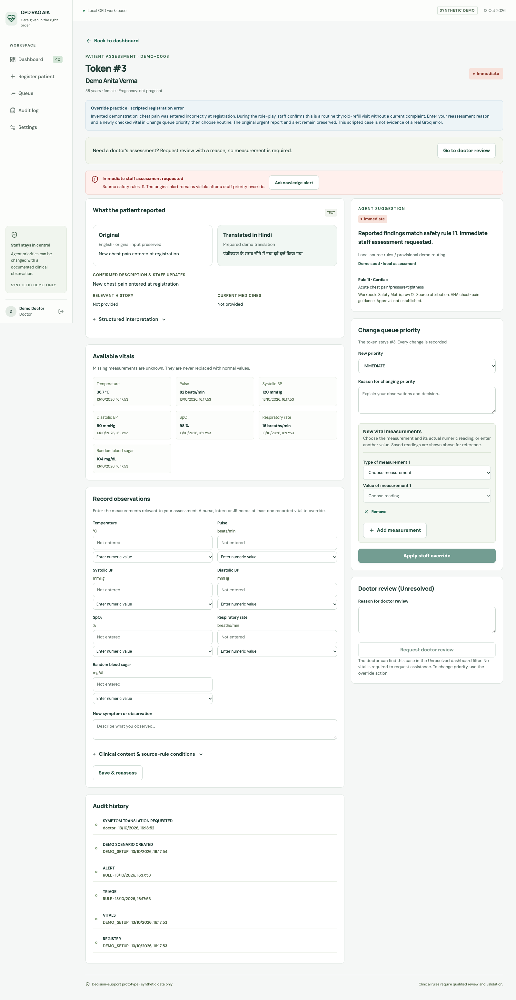
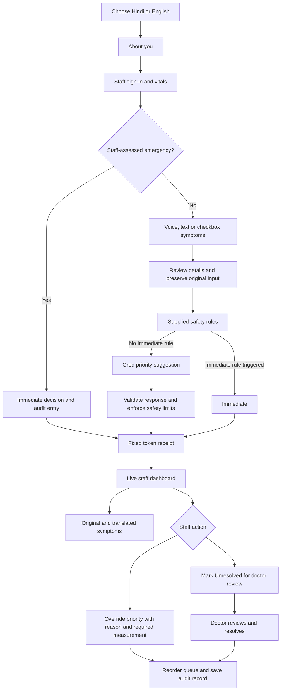

# OPD RAQ AIA

**Clinical urgency matters, not just parcha numbers.**

OPD RAQ AIA is a hackathon prototype for patient registration and queue prioritisation. It keeps each patient's original token number and orders the staff queue by Immediate, Soon or Routine. Doctors, nurses, interns and junior residents can review the assessment and change the priority.

**Synthetic demonstration only. This application has not been clinically validated and must not be used for real patient care.**

- [Live demo](https://opd-raq-aia.onrender.com)
- [GitHub repository](https://github.com/RujalRaj/OPD-RAQ-AIA)
- [Submission presentation — 10 slides](docs/presentation/OPD_RAQ_AIA_T05_AAYU-J9F7_Prototype.pptx)
- [Deployment setup](docs/deployment.md)
- [AI setup](docs/live-ai-setup.md)



## **Innovation**

The project combines an existing parcha/token system with a changing urgency queue. Token numbers stay fixed while Immediate, Soon and Routine determine the order staff see.

- **Language and input choice:** Hindi/English voice, text and eight groups of symptom checkboxes. The doctor can compare the original report with a translation.
- **Rules and live AI together:** the supplied safety matrix runs before Groq. Structured responses are checked by the backend before an AI suggestion is accepted.
- **Staff control:** a staff-assessed emergency can bypass symptom collection after the required vitals. Staff can change a priority or request doctor review, with an audit record.

The contribution is this OPD workflow and its integration. The pretrained model, clinical reference material and software libraries are credited below.

## **Healthcare experience**

The team information supplied for the presentation includes **Prof. Raj Kishore Singh — Medicine, BRD Medical College**, and **Dr. Aradhana Singh — OBG, AIIMS Gorakhpur**. These are team backgrounds, not institutional endorsements or evidence that the application has been clinically validated.

The intended setting is a government general OPD in Gorakhpur, Uttar Pradesh. The workflow reflects the team's requested constraints: staff-led registration, early vitals, Hindi/English symptom capture, stable parcha numbers, an emergency shortcut and escalation to a doctor when a case is unresolved. It does not require a doctor to approve every registration.

Formal clinical evaluation is still pending. The [source gaps](docs/source-gaps.md) record unresolved differences between the supplied safety matrix and example cases.

## **Working prototype**

> **Available now:** [Open the live demo](https://opd-raq-aia.onrender.com) · [View the code](https://github.com/RujalRaj/OPD-RAQ-AIA)

Registration, live Groq assessment, bilingual symptom reports, staff overrides, doctor review and audit history work in the prototype. The prepared starting queue has **3 Immediate, 7 Soon and 30 Routine synthetic patients**. Seed priorities are local-rule assessments; they are not presented as live model predictions.

Recorded checks for the current release include **195 backend tests, 9 frontend tests, 7 affected browser scenarios**, a production build, and hosted login/queue checks. Live Groq reassessment and translation were also checked with invented reports. These are software and connection checks, not clinical accuracy results. Details are in [verification history](docs/verification.md).

## **Impact**

| Intended benefit | What the prototype provides | What needs to be measured in a supervised evaluation |
| --- | --- | --- |
| Make urgent concerns visible earlier | Priority, a short reason and an Immediate-first queue | Time from registration to staff assessment; missed urgent cases |
| Reduce language and typing barriers | Hindi/English prompts, voice/text/checkbox input and original/translated reports | Completion time, assistance needed and translation errors |
| Keep decisions accountable | Staff identity, measurements, override reasons and audit history | Review time, reasons for disagreements and completeness of records |
| Fit an existing OPD queue | Original token retained when priority changes | Queue handling, staff workload and patient understanding |

No reduction in waiting time, improved health outcome or clinical accuracy percentage has been established. The current demonstration uses synthetic data only.

## What works

- Hindi and English registration with text, voice and grouped symptom checkboxes.
- Recorded spoken instructions with replay controls. Browser speech recognition is optional.
- Staff-led vitals entry before symptoms. Temperature and pulse accept a numeric reading or High/Low; SpO₂ requires a numeric reading. Other vitals can be recorded when available.
- A staff-assessed emergency shortcut that assigns Immediate and records the staff decision.
- Groq integration using `openai/gpt-oss-120b` for live priority suggestions, with the supplied safety rules checked first.
- A dashboard that opens on Immediate, with a dropdown for Soon and Routine. Original registration order remains visible.
- Separate **Original** and **Translated in Hindi/English** symptom boxes. Original input stays unchanged. Checkbox labels use the bilingual catalog; free text uses a cached translation. The prepared demo phrases also work offline.
- Staff overrides, unresolved cases sent for doctor review, and an audit trail.



## Current workflow



If the model is unavailable, the source-rule result remains visible with a request for staff review. The app does not mark a missing vital as normal. High/Low is a qualitative observation, not a fabricated numeric reading. Translation is for display and never changes the assessment.

## Tech stack

| Part | Technology |
| --- | --- |
| Interface | React 19, TypeScript, Vite 7, CSS |
| API | Python 3.12, FastAPI, Pydantic |
| Database | SQLite, SQLAlchemy 2 |
| Live AI | Groq API, `openai/gpt-oss-120b`, OpenAI Python SDK |
| Alternative provider | OpenAI API, `gpt-4o-mini` |
| Voice | Bundled Hindi/English audio, optional browser speech recognition |
| Tests | pytest, Vitest, Playwright, axe-core |
| Hosting | Docker; React build and FastAPI served from one origin |

We use a pretrained model through an API. We have not trained or fine-tuned a model. JSON schemas constrain responses; backend checks enforce permissions and preserve source safety rules and staff decisions.

## Run locally in VS Code

Install **Python 3.12**, **Node.js 24** and **Git**. Java is not required.

Clone the repository and open its root folder in VS Code:

```sh
git clone https://github.com/RujalRaj/OPD-RAQ-AIA.git
cd OPD-RAQ-AIA
python3.12 -m venv .venv
.venv/bin/python -m pip install -r backend/requirements-lock.txt
.venv/bin/python -m backend.seed_hackathon --activate
cd frontend
npm ci
cd ..
```

On Windows, use `py -3.12 -m venv .venv` and replace `.venv/bin/python` with `.venv\Scripts\python.exe`.

Start the backend in the first terminal, from the repository root:

```sh
.venv/bin/python -m uvicorn backend.main:app --reload --host 127.0.0.1 --port 8000
```

Start the frontend in a second terminal:

```sh
cd frontend
npm run dev
```

Open [the local app](http://127.0.0.1:5173). Do not run `backend/main.py` directly. Both terminals must stay open.

The included VS Code tasks can start the app, seed demo data and configure or check the AI connection.

## Connect Groq

Create a key at [Groq Console](https://console.groq.com/keys), then run from the repository root:

```sh
.venv/bin/python -m scripts.setup_ai --provider groq
.venv/bin/python -m scripts.check_ai
```

Paste the key into the hidden prompt. Restart the backend after changing its configuration. A successful connection check prints `LIVE RESPONSE VERIFIED`.

The key is stored in the ignored local `.env` file. It is never included in the React build or GitHub repository. A public deployment needs its own server-side environment variable; it cannot read your laptop's `.env` file.

## Demonstration

Choose a staff role and click **Fill credentials**, then **Open staff workspace**. Demo usernames are `nurse`, `doctor`, `intern` and `jr`; the shared demo password is `DemoOnly!2026`.

The curated starting queue contains **3 Immediate, 7 Soon and 30 Routine** patients. These are prepared local-rule cases, clearly labelled as demo seed assessments. New eligible registrations and reassessments use the configured live model.

**Override example:** open **Demo Anita Verma** in Immediate. The case includes a scripted registration-error scenario. Choose Routine, enter the staff clarification in the reason box, select Pulse and a synthetic reading such as 82 in the measurement box, then apply the override. The token stays the same and the patient moves to Routine. This is a rehearsed scenario, not evidence of a measured model error.

For nurse, intern and JR overrides, the backend requires a reason and at least one new numeric measurement. Doctors must supply a reason. **Request doctor review** marks a case Unresolved; only a doctor can resolve it with a note.

Running the seed command again preserves existing overrides. Previous active demo records are archived, not deleted, and a local database backup is created before activation.

## Tests

From the repository root:

```sh
.venv/bin/python -m pytest -q
.venv/bin/python -m backend.evaluate_cases
```

From `frontend`:

```sh
npm run test -- --run
npm run build
npx playwright install chromium
npm run test:e2e
```

Browser tests use separate local ports and a separate synthetic database. Automated tests check software behaviour, not clinical accuracy.

## Project files

- `frontend/src/`: registration, dashboard, patient detail and audio controls.
- `backend/main.py`: API routes, staff access, model jobs and translation jobs.
- `backend/services/`: safety rules, symptom processing, model calls and translation.
- `backend/fixtures/`: supplied safety matrix, bilingual catalog and synthetic cases.
- `tests/`, `frontend/e2e/`: API and browser checks.
- [Architecture and API](docs/architecture.md), [source gaps](docs/source-gaps.md), [verification history](docs/verification.md).

The original handoff and battle-plan workbook remain in the repository as reference documents. Later workflow changes are described here and in the implementation documentation.

## Current limits

This is a shared synthetic demo with fixed demonstration credentials. It has no real ABHA connection, diagnosis or prescription service. Model suggestions and translations can be wrong and need staff review. Browser speech recognition depends on browser support and may need internet. Hosted inference needs internet; the local database, form, recorded instructions and source-rule fallback can continue without it.

On a free Render instance, SQLite data is temporary and can reset when the instance restarts. The initial demo queue is restored only when the database is empty. Local SQLite data persists on the laptop. See [deployment details](docs/deployment.md).

## Acknowledgements and use of existing work

This is an **AI-assisted implementation** built from supplied project material and existing software. We used **OpenAI Codex/ChatGPT** to help generate and revise code, debug issues, write tests, prepare synthetic cases and bilingual wording, and produce documentation and presentation material. The team supplied the problem, workflow decisions and iterative corrections. We do not claim that all code was written manually or that the model was trained by us. Work developed across the preparation and hackathon iterations is part of this submission.

| Source, tool or asset | How it was used |
| --- | --- |
| **Aayu 2026 / DevAarambh, T05 “OPD Flow”** | The supplied problem statement and the token 87 / token 23 example establish the use case. The supplied Aayu presentation template, its background, logos and visual layout are reused in the submission deck. |
| **[PROJECT_HANDOFF.md](PROJECT_HANDOFF.md) and [Planout.xlsx](Planout.xlsx)** | Starting requirements, data/API design, synthetic examples and the Safety Matrix. The workbook was originally supplied as `Updated_PRANA_Hackathon_Battle_Plan.xlsx`. These references predate the implementation; later user-requested workflow changes are documented here. |
| **Team-supplied symptom text and workflow changes** | The bilingual symptom catalog, eight checkbox groups, required-vitals flow, emergency shortcut and review/override requirements were adapted from the supplied material and subsequent instructions. |
| **[WHO / ICRC / MSF Interagency Integrated Triage Tool](https://www.who.int/tools/triage)** | Background reference cited in the supplied material. The workbook also records NEWS2-informed and other clinical guardrails. Our rule implementation is derived from that workbook, not an independently validated implementation of IITT or NEWS2. |
| **[WHO: Ethics and governance of artificial intelligence for health (2021)](https://www.who.int/publications/i/item/9789240029200)** | Background reference for human oversight and responsible health AI. This does not imply WHO approval. |
| **[Groq](https://console.groq.com/docs/model/openai/gpt-oss-120b), OpenAI GPT-OSS 120B and the [OpenAI Python SDK](https://github.com/openai/openai-python)** | Groq hosts the pretrained `openai/gpt-oss-120b` model used for live priority suggestions and free-text translation. The SDK connects to Groq's compatible API. An alternative OpenAI provider is supported; the submitted live demo uses Groq. No training or fine-tuning was performed. |
| **React, React DOM, TypeScript, Vite and CSS** | Frontend components, type checks and build tooling. See the exact dependency inventory below. |
| **Python, FastAPI, Starlette, Pydantic, SQLAlchemy, SQLite, Uvicorn, HTTPX and python-dotenv** | API, validation, persistence, web serving, provider communication and local configuration. |
| **[Lucide](https://lucide.dev/), [Fontsource](https://fontsource.org/), DM Sans, Manrope and Noto Sans Devanagari** | Interface icons and bundled fonts. Their upstream licences and notices are retained in [third-party notices](THIRD_PARTY_NOTICES.md). |
| **[edge-tts](https://github.com/rany2/edge-tts) and Microsoft Edge voices** | Fixed instructional audio generated with `hi-IN-SwaraNeural` and `en-IN-NeerjaNeural`, then bundled for local playback. PyAV and NumPy were used to assemble the clips. Audio generation uses the upstream speech service; it is not a model we created. |
| **gTTS / Google Translate TTS; faster-whisper / CTranslate2 / Whisper** | gTTS generated the earlier retained Hindi instruction asset. Local faster-whisper `medium` checked the words in generated audio. This was a development check; Whisper is not the application's speech-input service. See [audio provenance](docs/hindi-audio-verification.json) and [current audio checks](docs/instruction-audio-verification.json). |
| **Browser Web Speech API** | Optional Hindi/English speech recognition. Availability and processing depend on the browser. The current instruction prompts use bundled audio. |
| **pytest, Vitest, Playwright, Testing Library, axe-core, Ruff and Prettier** | Software testing, selected accessibility checks, linting and formatting. Automated checks do not establish clinical or accessibility certification. |
| **Git, GitHub, VS Code, Docker and Render** | Development, source hosting, container packaging and demo hosting. |
| **Codex presentation tools (`@oai/artifact-tool`)** | Used to edit, render and check the revised submission presentation. The Aayu template remains the visual source. |
| **Synthetic data and screenshots** | Supplied examples were used as references; the current 40-person demonstration queue was generated for this app. Screenshots are captures of our synthetic demo. No real patient dataset was used. |

The [third-party inventory](THIRD_PARTY_NOTICES.md) lists direct and transitive locked packages, versions and declared licences, with retained notices for bundled fonts and icons. Original ownership and licence terms remain with their authors. This declaration describes identified sources and tools; it does not claim ownership of third-party material or permission beyond its applicable terms.

## Future prospect

1. **ABDM / ABHA integration:** connect registration with the ABDM sandbox, then follow the requirements for authorised patient record access.
2. **Clinician assistance in diagnosis:** use symptoms, vitals, patient history and the doctor's conversation to support the clinician's assessment, with clinician review.
3. **Prescription and patient leaflet:** draft a prescription sheet for the doctor to approve, with patient instructions in the patient's language.
4. **Follow-up and emergency reminders:** send follow-up reminders and allow patients to alert the care team about an emergency. This would need a defined response process.
5. **Better model integration:** compare models on Hindi, English and locally used expressions before selecting them for the workflow.
6. **More comprehensive safety rules:** expand the rules with clinician input and evaluate them before any clinical use.
7. **Offline operation:** support local inference and a local network deployment for medical colleges with unreliable internet. Operation during a power cut would still require charged devices or backup power.
